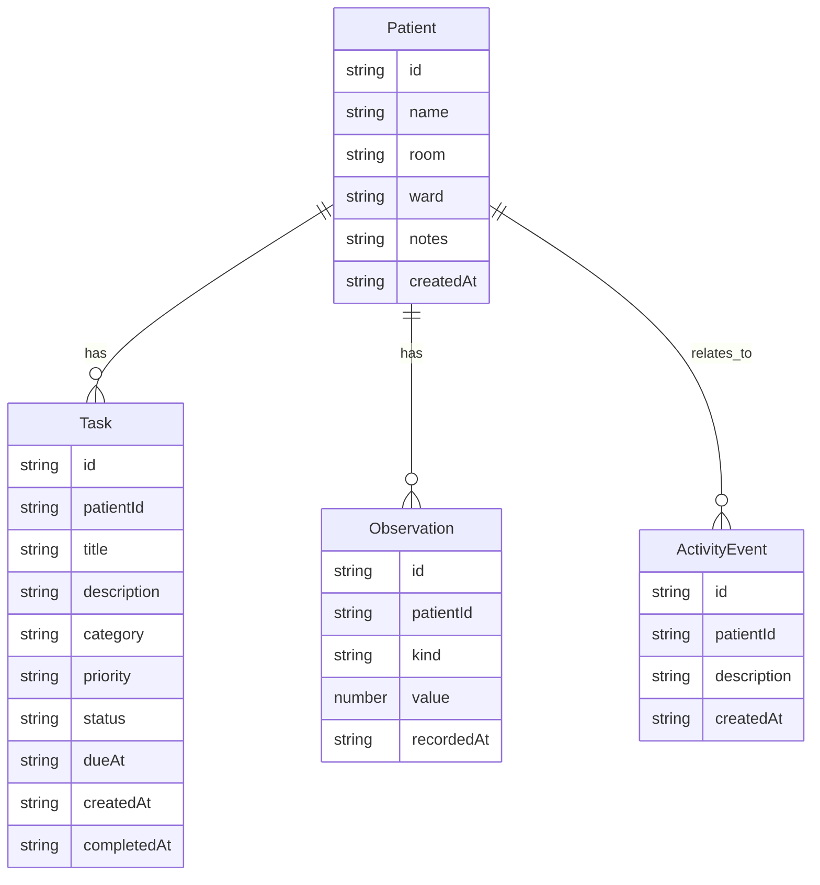
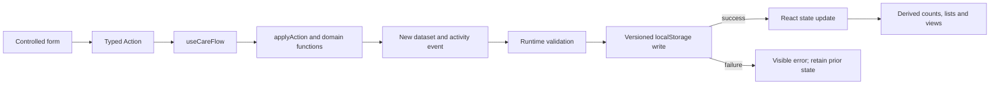

# CareFlow architecture

## From starter to unified workspace

The audited starter had two incompatible task models: nested `{ id, label }`
checklist items with a separate boolean status map, and full created `Task`
records. Only the original checklist could be completed. `App` directly owned
separate persistence flows; a second stylesheet lived under `storage` without
being imported; the original custom modal had no focus behavior.

The implementation preserves the fictional starter content and saved legacy data,
while replacing those disconnected paths with one coherent application dataset.

## Data model

`dueAt` and `completedAt` can be null. Workspace events can have a null
`patientId`. IDs are stable UUIDs for new records; original starter IDs are kept.
A task describes work to do. An observation is an entered measurement; creating
an Observation task does not automatically record a value or complete anything.

## Responsibilities and flow

- `App` composes views and selects dialogs; it does not construct or persist records.
- `useCareFlow` coordinates synchronous read/modify/save/state operations. A ref
  retains the latest committed dataset between rapid event callbacks.
- `applyAction` is the domain transaction boundary: it chooses an operation and
  appends the corresponding actual activity event. It does not render or access storage.
- Domain functions validate inputs and return new records/collections.
- `useFormSubmit` prevents repeated submissions with a ref, supplies pending/error
  states, and unlocks after a failure so users can retry without losing input.
- `saveCareFlowData` validates and serializes all collections in one local write.
- `filterTasks` and `getDashboardSummary` derive views without altering saved data.
- Hash routes support refresh and browser back/forward without a router dependency.
- Native dialogs provide the top layer/inert background; explicit first/last Tab
  wrapping and focus return improve keyboard behavior. The fallback focus target
  is the main heading if the original button has disappeared.

One named reusable function or component lives in each file. Short event handlers,
array/test callbacks, and framework effect callbacks stay inline. The tiny `close`
callback in `DialogRouter` is local event wiring rather than a reusable helper.
Class files contain their creator contract or concrete factory method.

## Factory Method

`TaskFactory` is an abstract creator contract. Its concrete creators implement
`createTask`, supplying their category to shared `createTask` construction.
`selectTaskFactory` is itself a simple factory function: it selects a creator;
Factory Method is the subclass implementation of that creator's creation method.

The benefit here is practicing polymorphism and separating creation from consumers.
The cost is additional indirection/files. The concrete behavior currently differs
only by category, so a function would be simpler outside this learning objective.
Validation and record creation are shared; duplicated object literals are removed.

Edits use `updateTask`. They preserve identity, patient association, creation time
and completion metadata. Changing category is an update, not a new factory creation.
`toggleTaskStatus` records completion time and clears it on reopening.

## Storage protocol and migration

The v2 envelope is `{ version: 2, revision: UUID, data: CareFlowData }`.
On load, parsed JSON is `unknown`. Separate type guards narrow records only after
checking required fields, enum values, timestamps, duplicates and relationships.
Completed tasks require a completion timestamp no earlier than creation.

If v2 exists but cannot be validated, loading blocks. There is no fallback write.
If v2 is absent, migration normalizes the original starter records and reads both
legacy keys. It preserves IDs, descriptions, original timestamps and checkbox
completion. Missing task category/priority/due fields receive explicit defaults.
Unknown IDs, duplicates, broken relationships and malformed data block migration
instead of silently dropping records. Legacy raw entries are retained.

Starter checklist timestamps did not exist, so import-time estimates are used and
identified in task descriptions and the actual import event. No historical task
completion actions are invented. Seed-only activity starts empty. Migration is
written on the next successful action; an untouched fresh demo has not yet been saved.

Save checks the expected revision before writing, rejecting stale tabs and invalid
current envelopes. localStorage read-then-write is not an atomic compare-and-swap;
simultaneous tabs can still race. This is a standalone, single-editor prototype.

Corrupt data is protected by a dedicated recovery view. Its export captures all
three raw storage entries without parsing or replacing them. Fixing data or restoring
a supported app version is an explicit external recovery step; no silent reset occurs.

## Deletion policy

Patient deletion cascades through its tasks, observations and patient-specific
activity; a workspace removal event with null `patientId` remains. Other patients'
records remain unchanged. Task/observation deletion retains its corresponding
activity description. This behavior is described before confirmation and tested.

## Product and accessibility decisions

- localStorage is sufficient for small fictional records; IndexedDB would add
  asynchronous plumbing without a present dataset-size requirement.
- No server, state library, synthetic Observer, or decorative statistics.
- Search/filter/count results are derived; activity records actual actions only.
- Semantic buttons and tables, labeled controlled inputs, focus-visible styles,
  status/error regions, Escape handling, and narrow-screen layouts.
- Broad measurement entry bounds check finite/numeric values. They are not clinical
  reference ranges and do not trigger diagnostic classifications or alerts.
- The already-loaded app works without a network. No service worker is installed,
  so reliable offline reload is intentionally not claimed.

## Verification strategy

Vitest covers factories, domain validation/updates, query behavior, deletion,
activity, runtime storage validation, failures and legacy migration. React Testing
Library exercises form-to-storage-to-render behavior and blocked saves. Playwright
runs the production bundle in local Chrome at desktop and mobile widths, checking
full user journeys, refresh, native-dialog keyboard behavior, recovery downloads,
legacy migration, local saves while disconnected and document overflow. Axe scans
representative views/forms; it cannot certify complete accessibility or compliance.

Use `npm test`, `npm run typecheck`, `npm run lint`, `npm run format:check`,
`npm run build`, then `npm run test:e2e`. Browser results are limited to the engines
actually executed. No clinical, security or regulatory validation is implied.
