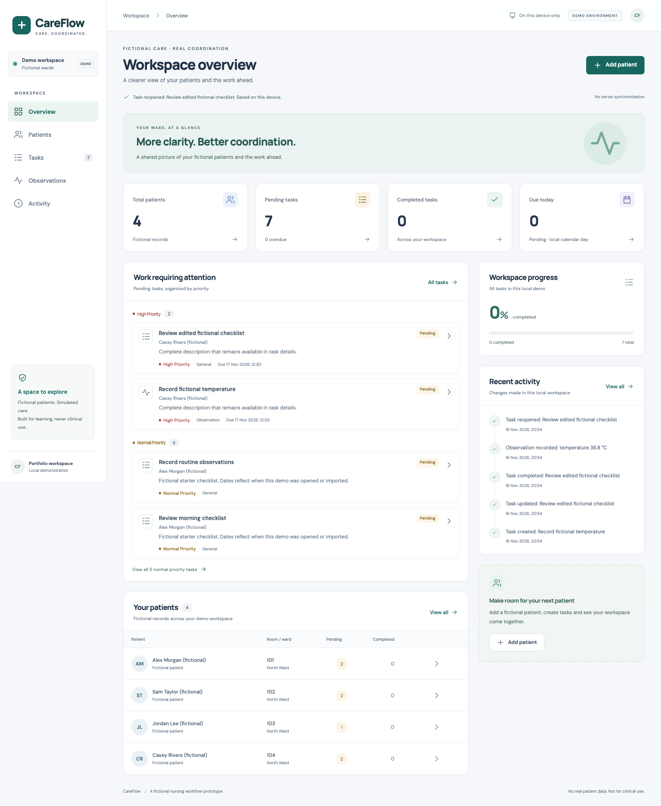

# CareFlow

**A fictional nursing workflow workspace — built with React and TypeScript.**

CareFlow explores a practical coordination problem: keeping patient-related work,
priorities and simple observation records visible in one place. It is a portfolio
prototype for nurses and shift coordinators in a simulated ward, with an emphasis
on clear interaction design, reliable local persistence and understandable code.

**All patients and measurements are fictional. This is not clinically validated,
not an EHR, and not suitable for real patient care. Never enter real patient data.**



[Mobile screenshot](docs/screenshots/mobile-overview.png) ·
[Architecture](ARCHITECTURE.md) · [Code walkthrough](docs/LEARNING.md) ·
[Demonstration script](docs/DEMO.md)

## Features

- Ward overview with actual patient, pending, completed, due-today and overdue counts.
- Pending work grouped by priority and a completion progress bar derived from tasks.
- Searchable patient directory, editable profiles, ward/room information and notes.
- Patient-specific task, observation and activity workspaces.
- General and Observation task creation through Factory Method creators.
- Full task details, editable descriptions/categories/priorities/due dates,
  completion/reopening with timestamps, and confirmed deletion.
- Combined task search, status/category filtering and priority/due-date/newest sorting.
- Fictional temperature and heart-rate entry, history, patient filtering and removal.
- Activity events recorded from actual changes, saved with the affected records.
- Versioned local storage, legacy-data migration, failure feedback and a recovery
  screen that protects malformed data and can export the original storage.
- Responsive navigation, semantic tables and buttons, native dialogs, Escape,
  focus wrapping/return, visible focus styles and a skip link.

## Run locally

Use Node **22.22.2+ (22.x), 24.15+ (24.x), or 26+** to satisfy the installed build,
unit-test and lint dependencies. This project was verified with Node 26.13.0.

```bash
npm ci
npm run dev
```

Run commands from this `careflow/` directory. Open the URL printed by Vite.
The lockfile pins dependency versions. The app has no backend or environment secrets.

```bash
npm test               # Vitest unit and React interaction tests
npm run typecheck      # Strict TypeScript check
npm run lint           # ESLint, including React hook rules
npm run format:check   # Prettier consistency
npm run build          # TypeScript and production bundle
npm run preview        # Serve the production bundle locally
npm run test:e2e       # Production browser tests; build first
```

Playwright uses the locally installed macOS Chrome by default. On another machine,
set `CHROME_PATH` to an installed Chrome/Chromium executable, for example:

```bash
CHROME_PATH=/usr/bin/chromium npm run test:e2e
```

The browser suite starts a production preview on `127.0.0.1:4178`. Its desktop and
mobile projects exercise the full workflow, keyboard dialogs, refresh restoration,
legacy migration, recovery export, deletion and disconnected local saving. Axe
checks the main views/forms for automated WCAG A/AA issues. Automated scanning
is not a substitute for testing with assistive technology.

## Technology and project structure

Runtime: React 19, TypeScript, Vite, CSS and browser localStorage. No state-management
or UI framework dependencies. Development tools include Vitest, Testing Library,
jsdom, Playwright, axe, ESLint and Prettier.

```text
src/
  components/   Views, cards, forms, dialogs and shared presentation
  data/         Original starter records and normalized demo-data creation
  factories/    Abstract TaskFactory and two concrete task creators
  hooks/        App-state persistence, form submission, navigation, connectivity
  logic/        Validation, creation, immutable updates, queries, formatting
  storage/      Runtime guards, migration and versioned load/save
  types/        Patient, Task, Observation, ActivityEvent and action contracts
  test/         Unit-test environment setup
  App.tsx       View/dialog composition
  styles.css    Shared visual system and responsive layouts
e2e/            Real-browser workflow, reliability and accessibility tests
docs/           Screenshots, learning guide and demonstration script
```

## Engineering decisions and why we chose them

| Decision                                  | Reason for this project                                                                                                                               | Trade-off / alternative                                                                                                              |
| ----------------------------------------- | ----------------------------------------------------------------------------------------------------------------------------------------------------- | ------------------------------------------------------------------------------------------------------------------------------------ |
| React + strict TypeScript                 | Reusable views and explicit contracts make patient/task relationships and form inputs easier to understand and change.                                | Types catch development mistakes; they do not validate JSON or prove runtime correctness.                                            |
| Normalized collections linked by IDs      | One task model replaces the starter's nested checklist and separate created-task list. Editing, completion and counting now share the same records.   | Views must join records by `patientId`; nesting would simplify initial rendering but duplicate update paths.                         |
| Derived counts and filters                | Dashboard numbers and filtered lists are calculated from actual records, so there are no separate counters to keep synchronized.                      | Queries rerun when rendering; suitable for this small demo, not optimized for very large datasets.                                   |
| Small domain functions outside components | Validation, creation, editing and filtering can be tested without rendering React. Components concentrate on collecting input and presenting results. | More files, but each has a clear responsibility. Short local callbacks remain inline.                                                |
| React state plus a custom hook            | `useCareFlow` coordinates one source of truth and persistence without introducing a state library.                                                    | Prop passing is explicit; Context or a store may become useful if the component tree grows.                                          |
| Immutable updates                         | New objects/arrays preserve the previous state, making React updates and regression tests predictable.                                                | Copying collections is less efficient than mutation at large scales; clarity matters more here.                                      |
| localStorage and one versioned envelope   | Small text records fit a synchronous standalone prototype. One write saves records and their activity together.                                       | Storage is browser/origin-specific, blocking and quota-limited. IndexedDB would suit larger datasets and asynchronous storage needs. |
| Save before accepting state               | A failed save leaves the displayed records unchanged and the form open; success feedback follows a successful write.                                  | Users cannot continue unsaved editing through a storage failure; this avoids pretending changes are durable.                         |
| Runtime guards and conservative migration | Parsed storage is untrusted `unknown`, even in a TypeScript app. Invalid records must not disappear during loading or migration.                      | Corrupt data blocks editing and needs explicit recovery instead of silently resetting the demo.                                      |
| Native HTML dialogs                       | Built-in modal semantics and an inert background reduce the amount of custom accessibility code.                                                      | Focus wrapping/return still needs care, and native behavior must be checked in a real browser.                                       |
| Hash navigation                           | Refreshable patient URLs and browser back/forward work without server routing or another runtime dependency.                                          | Less flexible than a router for nested routes, authorization and complex navigation.                                                 |
| Separate observations and tasks           | A task is planned work; an observation is an entered fictional measurement with a time and value.                                                     | Recording a measurement does not automatically complete an Observation task; there is no hidden clinical workflow.                   |
| Confirmed cascading patient deletion      | Associated tasks and observations cannot remain orphaned after their patient is removed.                                                              | Patient-specific history is also removed; the confirmation explains this and a workspace removal event remains.                      |

### How a change moves through the application

```text
Controlled form → typed action → useCareFlow → applyAction
    → domain operation + actual activity event
    → runtime validation → versioned localStorage write
    → React state update → refreshed lists and derived counts
```

A controlled input stores its value in React state. The submitted `Action` is a
TypeScript discriminated union: its `type` determines the fields that operation
requires. `applyAction` constructs the next dataset without changing the old one.
The hook saves first and accepts that dataset only after success. Ref-based form
locking prevents rapid duplicate submissions before React has re-rendered.

## Factory Method design pattern

A **factory** is code responsible for constructing an object. **Factory Method**
uses a shared creator abstraction whose creation method is implemented by subclasses.
Consumers call that contract without needing to construct the concrete product themselves.

| File                                                                   | Role                                                                                                    |
| ---------------------------------------------------------------------- | ------------------------------------------------------------------------------------------------------- |
| [`TaskFactory.ts`](src/factories/TaskFactory.ts)                       | Abstract creator: requires `createTask(input): Task`; it cannot be instantiated directly in TypeScript. |
| [`GeneralTaskFactory.ts`](src/factories/GeneralTaskFactory.ts)         | Concrete creator: creates a General task.                                                               |
| [`ObservationTaskFactory.ts`](src/factories/ObservationTaskFactory.ts) | Concrete creator: creates an Observation task.                                                          |
| [`selectTaskFactory.ts`](src/logic/selectTaskFactory.ts)               | Chooses a creator from the requested category and rejects unsupported categories.                       |
| [`createTask.ts`](src/logic/createTask.ts)                             | Shared record construction: validates fields, trims text and supplies ID, timestamps and initial state. |
| [`updateTask.ts`](src/logic/updateTask.ts)                             | Edits an existing record while preserving its identity and original creation/completion metadata.       |

The creator contract and one implementation are small:

```typescript
export abstract class TaskFactory {
  abstract createTask(input: CreateTaskInput): Task;
}

export class ObservationTaskFactory extends TaskFactory {
  createTask(input: CreateTaskInput): Task {
    return createTask(input, "observation");
  }
}
```

When the user submits `TaskForm`, React sends a `task.create` action. `applyAction`
checks the patient association and then invokes:

```typescript
const task = selectTaskFactory(action.input.category).createTask(action.input);
```

The selected creator supplies its category and delegates common validation and
construction. The resulting record has a unique ID, patient association, trimmed
title/description, priority, optional due date, creation time, pending status and
null completion time. It is saved through the same transaction path as other actions.

**The selector and Factory Method play different roles.** `selectTaskFactory` is
a simple factory function that chooses a creator. The subclass implementations of
the shared `createTask` method are the Factory Method part. A plain function could
select a category and return a task without any class hierarchy.

We retained Factory Method to practice polymorphism and isolate category-specific
creation behind a clear contract. A new category can receive its own creator;
the category type and selector must also be extended. Consumers still invoke the
same creation method. Shared construction avoids copying IDs, defaults and
validation across subclasses.

**The trade-off is deliberate:** today's concrete factories differ only by category,
so the pattern adds files and indirection without a strong functional necessity.
A single creation function would be sufficient for the current product. The
implementation keeps the learning exercise without inventing medical behavior or
adding unrelated patterns. Changing an existing task's category is an ordinary
immutable update, not a reason to generate a new ID or recreate the task.

## Testing strategy: what is tested and why

We use several layers because each catches a different class of mistake.

| Test layer                          | Tools and files                                                                                                                | What it verifies                                                                                                                                                                                                        | Why this layer / its limits                                                                                                                            |
| ----------------------------------- | ------------------------------------------------------------------------------------------------------------------------------ | ----------------------------------------------------------------------------------------------------------------------------------------------------------------------------------------------------------------------- | ------------------------------------------------------------------------------------------------------------------------------------------------------ |
| Domain unit tests                   | Vitest: [`domain.test.ts`](src/logic/domain.test.ts), [`GeneralTaskFactory.test.ts`](src/factories/GeneralTaskFactory.test.ts) | Patient creation/editing, required fields, factories/selection, task defaults/edits/deletion, timestamps, reopening, observation validation, query filters/sorting, dashboard counts and activity/deletion behavior.    | Fast, focused feedback on business rules. Does not demonstrate that a real user can operate the interface.                                             |
| Persistence and migration tests     | Vitest: [`persistence.test.ts`](src/storage/persistence.test.ts)                                                               | Serialization/restoration of entities, malformed JSON, unsupported schemas, invalid associations/dates/duplicates, unavailable storage, stale revisions, legacy checkbox/task migration and retention of original keys. | Targets data-loss risks directly. Browser storage is simulated, so real-browser coverage is still needed.                                              |
| React interaction/integration tests | Testing Library + user-event + jsdom: [`App.test.tsx`](src/App.test.tsx)                                                       | Patient → task → editing → completion → observation → activity → remount, visible save failures, retained form input, duplicate submission, confirmation/cancellation and no-results states.                            | Tests components, domain operations and persistence together through user-facing controls. jsdom has no real modal top layer or layout.                |
| Production end-to-end tests         | Playwright + installed Chrome: [`workflow.spec.ts`](e2e/workflow.spec.ts)                                                      | Full create/edit/complete/reopen journey, counts, task details, all main navigation, refresh persistence, deletion, Escape, focus containment/return and page overflow at desktop/mobile widths.                        | Exercises the actual built bundle and native browser behavior. Mobile uses an emulated viewport/touch environment, not a physical device.              |
| Browser reliability tests           | Playwright: [`reliability.spec.ts`](e2e/reliability.spec.ts)                                                                   | Disconnected saves in an already-loaded app, actual localStorage migration, recovery-file download, dashboard filter shortcuts, patient edits, observation removal and stale second-tab protection.                     | Verifies integration with browser capabilities that mocks alone cannot establish. Does not promise offline reload or eliminate simultaneous-tab races. |
| Automated accessibility tests       | axe through Playwright: [`accessibility.spec.ts`](e2e/accessibility.spec.ts)                                                   | Representative main views and dialogs scanned for WCAG A/AA rules, including names, labels and text contrast. Keyboard assertions also run in workflow tests.                                                           | Catches repeatable issues early. A passing scan is not accessibility certification or a screen-reader usability assessment.                            |
| Static and build checks             | TypeScript, ESLint, Prettier, Vite                                                                                             | Type contracts, hook rules, common code mistakes, formatting and production bundling.                                                                                                                                   | Useful engineering checks, but compilation and formatting do not prove correct behavior.                                                               |

Unit tests exercise both valid and invalid inputs, and use a controlled clock for
completion timestamps. Storage failures are deliberately injected to confirm that
failed writes never produce successful UI updates. Migration fixtures include tasks
from before category/priority/due fields existed. These cases target realistic
regressions rather than simply repeating implementation details in assertions.

Testing Library uses accessible roles and labels so tests follow the same controls
users encounter. Native-dialog focus and visual overflow are checked in Chrome,
not inferred from jsdom. Browser tests use a fresh isolated context per test and
never access the user's existing browser profile or real saved data.

Run the checks in this order:

```bash
npm test
npm run typecheck
npm run lint
npm run format:check
npm run build
npm run test:e2e
```

### Verification completed for this implementation

- Vitest: **54 tests passed** across domain, persistence and React interaction tests.
- Playwright: **18 tests passed** across desktop and mobile Chrome projects,
  including automated accessibility scans of main views and dialogs.
- Strict TypeScript, ESLint, Prettier and the production build all passed.

These results describe the checks actually executed for this implementation, not a
promise that future edits or different browser environments will pass automatically.

Current scope does not include a backend API, authentication, clinical algorithms,
load testing, penetration testing, cross-browser certification or regulatory
validation. Those capabilities must not be inferred from a green test suite.

## Persistence, migration and recovery

The active key is `careflow-data-v2`, containing `{ version, revision, data }`.
Runtime guards check fields, enum values, dates, unique IDs, completion consistency
and patient associations. TypeScript types alone cannot validate browser storage.

When v2 is absent, CareFlow converts the original nested starter checklist, applies
`careflow-task-status-v1`, and merges `careflow-created-tasks-v1`. Older tasks without
a category become General tasks; priority defaults to Normal and due dates to unset.
The first successful action writes the unified format. Both legacy keys remain
untouched. Migration does not fabricate historical activity. Checklist timestamps
that were never recorded are explicitly described as import-time estimates.

Malformed or unsupported data opens recovery and blocks editing. It is never
silently replaced with demo data. Export the original JSON before repairing it;
then fix the relevant storage entry or restore its original application version and
retry. There is deliberately no automatic destructive reset.

Revisions detect ordinary stale writes from another tab. They are a best-effort
check, not a database transaction or a guarantee against simultaneous multi-tab
races. Browser storage can be blocked, cleared, run out of space, or be lost with
a browser profile. Use one active editing tab for the demonstration.

Removing a patient requires confirmation and removes its associated tasks,
observations and patient activity. A workspace-level removal event remains.
Deleting a task or observation keeps a corresponding activity event.

## Connectivity and limitations

An already-open workspace can save local changes while disconnected; this is
covered by a browser test. There is **no service worker or cached app shell**, so
an offline reload is not guaranteed. The connectivity label reflects the browser's
online/offline signal, not a verified connection to any service.

Data remains in this browser and origin (scheme, host and port). Changing the dev
server port opens a different storage area; use the original origin to find earlier
data. There is no synchronization, sign-in, authorization, encrypted record storage,
clinical interpretation, medication administration or hospital integration. Activity
is an editable local demo history, not a tamper-resistant clinical audit trail.

Typography uses Google Fonts with local system fallbacks; network access is optional
for loading those fonts. The interface and loaded workflows do not depend on them.
Dates are stored as instants and displayed in the user's local timezone. Due-today
uses the local calendar day and counts pending tasks only.

## Planned improvements

- Test with assistive technology and additional browser engines.
- Self-host fonts and add deliberately versioned app-shell caching if offline
  reload becomes a product requirement.
- Introduce a backend and authentication only with a separately designed security,
  privacy and synchronization model.
- Pagination and indexed storage if the demonstration dataset becomes large.

See the learning guide for exact affected files, design trade-offs and exercises.
